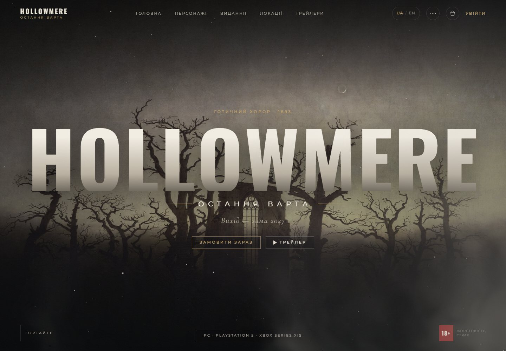
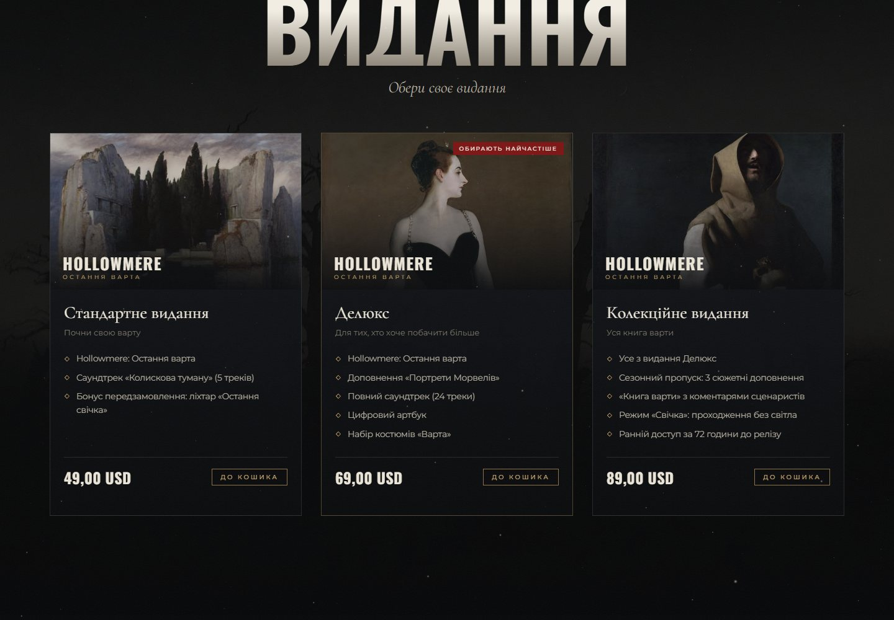
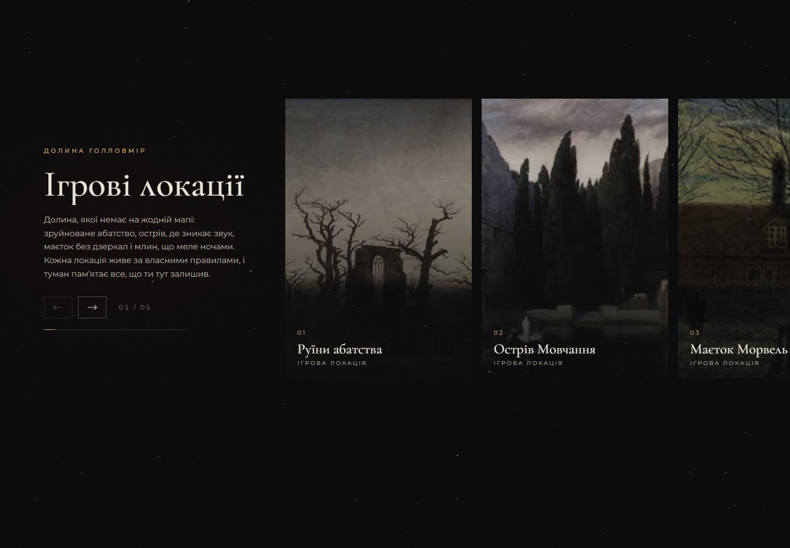
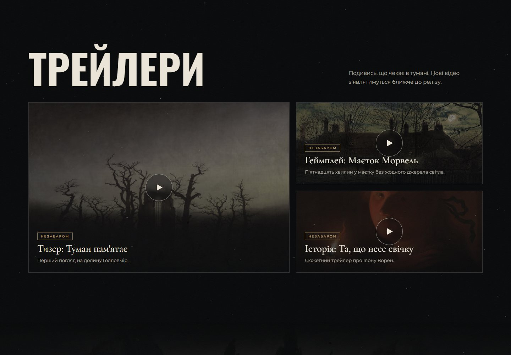
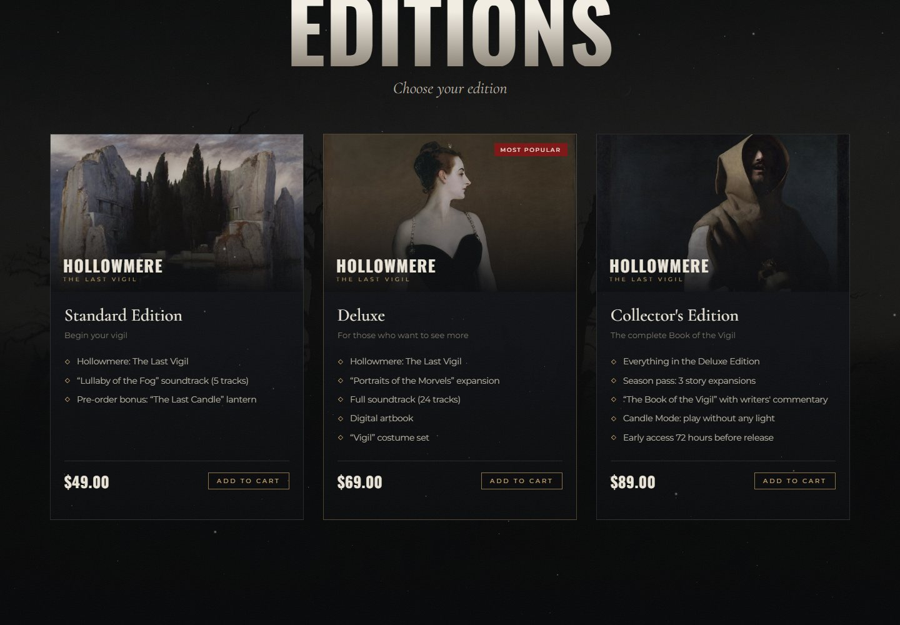
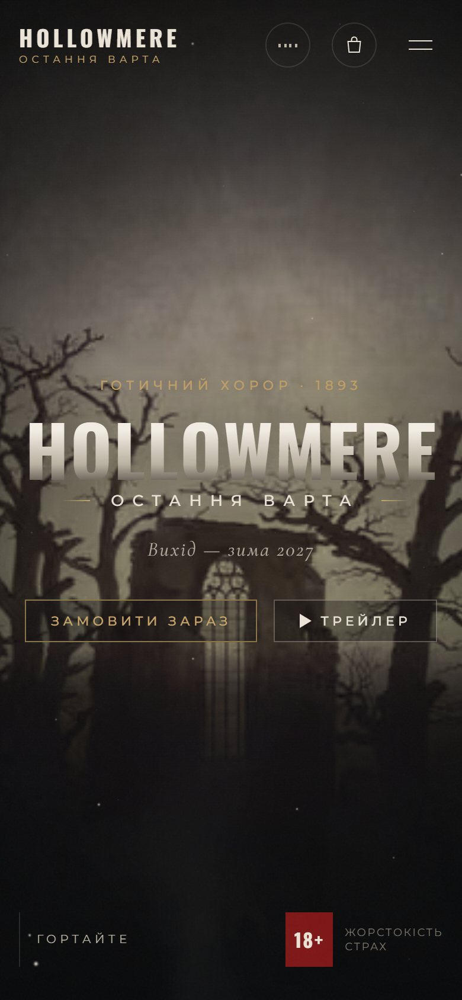
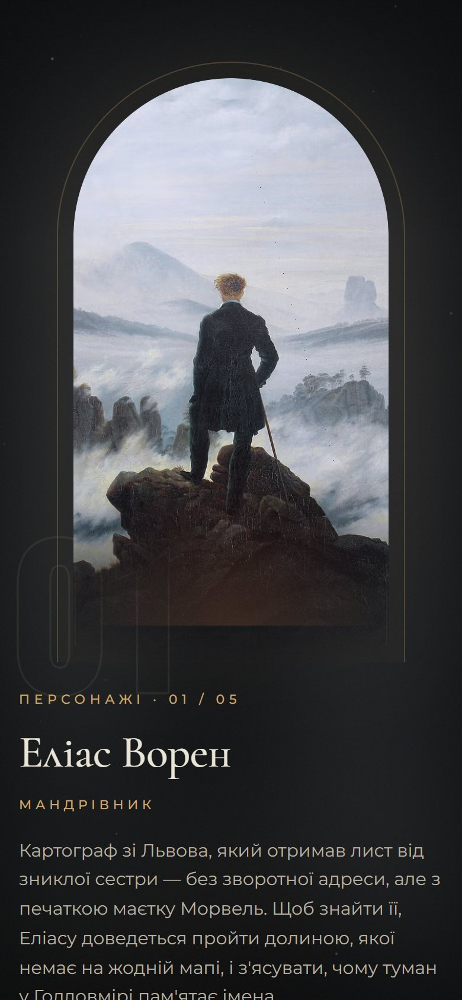
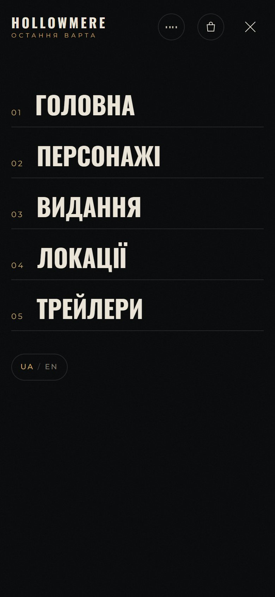
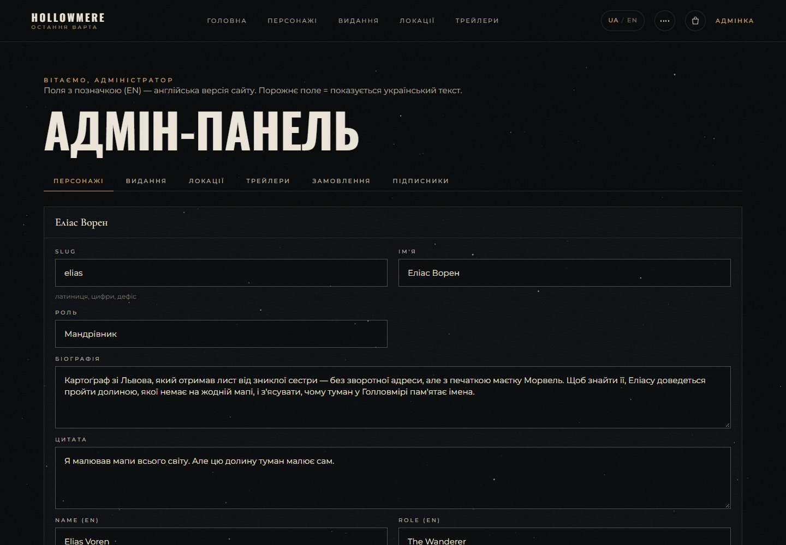

# Hollowmere — Остання варта / The Last Vigil

**English.** Hollowmere: The Last Vigil is a full-stack website for a fictional gothic horror game, built as a demo project. A visitor explores the game's characters, editions, locations and trailers on an animated landing page with a Three.js snow-and-fog layer, GSAP animations, a preloader, a custom cursor and procedural ambient sound. The artwork is public-domain 17th–19th century paintings. Visitors can create an account, fill a cart and check out through Stripe (demo mode without a key), and subscribe to a newsletter. An admin panel lets the owner edit all content and view orders and subscribers. The site is available in Ukrainian and English.

Stack: Next.js 16, React 19, TypeScript, PostgreSQL with Prisma 7. Security: Argon2id password hashing, hashed server-side sessions, rate limiting, a nonce-based Content-Security-Policy, input validation, and verified Stripe webhooks.

**Українською.** Hollowmere: Остання варта — повноцінний вебсайт вигаданої готичної хорор-гри, створений як демонстраційний проєкт. Відвідувач знайомиться з персонажами, виданнями, локаціями й трейлерами на анімованій сторінці зі снігом і туманом на Three.js, анімаціями GSAP, прелоадером, власним курсором та згенерованим фоновим звуком. Ілюстрації — картини XVII–XIX століть у суспільному надбанні. Можна створити акаунт, наповнити кошик і оформити замовлення через Stripe (без ключа — у демо-режимі), а також підписатися на розсилку. В адмін-панелі власник редагує весь контент і переглядає замовлення та підписників. Сайт доступний українською та англійською.

Стек: Next.js 16, React 19, TypeScript, PostgreSQL з Prisma 7. Безпека: хешування паролів Argon2id, сесії з хешованими токенами на сервері, обмеження частоти запитів, Content-Security-Policy з nonce, валідація вхідних даних і перевірка підпису вебхуків Stripe.

## Скріншоти / Screenshots



| | |
| --- | --- |
|  |  |
|  |  |
|  |  |

Мобільна версія / Mobile:

<p>
  
  
  
</p>

Адмін-панель / Admin panel:



## Запуск локально

Потрібен Node.js 20+. PostgreSQL окремо ставити не треба.

```bash
npm install          # також генерує Prisma Client
npm run setup        # створює .env із випадковими секретами та паролем адміна (виводить їх у консоль)
npm run db           # локальний PostgreSQL на 127.0.0.1:5433 — тримайте вікно відкритим
# у другому терміналі:
npm run db:migrate   # застосувати схему
npm run db:seed      # персонажі, видання, локації, трейлери + акаунт адміна з .env
npm run dev          # http://localhost:3000
```

`npm run db` бере справжні бінарники Postgres з npm-пакета `@embedded-postgres/*` і копіює їх разом із даними в `%LOCALAPPDATA%\hollowmere`. Так зроблено тому, що `initdb` не працює зі шляхами, де є кирилиця, а OneDrive блокує файли, у які пише база.

Вхід в адмінку: `/login` з `ADMIN_EMAIL` / `ADMIN_PASSWORD` з `.env`, після цього відкрийте `/admin`.

## Структура

| Шлях | Що там |
| --- | --- |
| `src/app/page.tsx` | Головна: збирає секції з даних у БД |
| `src/components/home/*` | Hero, слайдер персонажів, видання, локації, трейлери, підписка |
| `src/components/fx/*` | Прелоадер, плавна прокрутка (Lenis), курсор, WebGL-атмосфера, анімації появи |
| `src/lib/ambient.ts` | Атмосферний звук, згенерований Web Audio API (файлів немає) |
| `src/app/actions/*` | Server Actions: авторизація, кошик, оформлення замовлення, підписка, адмінка |
| `src/lib/*` | Сесії, паролі, обмеження частоти запитів, валідація, Stripe |
| `src/proxy.ts` | CSP з nonce для кожного запиту й попередня перевірка доступу |
| `prisma/` | Схема, міграції, сід |

## Мови (UA / EN)

- Перемикач у шапці (і в мобільному меню) зберігає вибір у cookie `hm_lang`; без cookie мова визначається з `Accept-Language` браузера, за замовчуванням — українська.
- Тексти інтерфейсу — у [src/i18n/dictionaries.ts](src/i18n/dictionaries.ts) (тип `Dictionary` гарантує, що обидві мови мають однаковий набір ключів).
- Контент з БД (персонажі, видання, локації, трейлери) має поля `*En`, які редагуються в адмінці з позначкою (EN). Порожнє поле — показується український текст.
- Ціни й дати форматуються за мовою (`49,00 USD` / `$49.00`), Stripe Checkout відкривається англійською для EN.

## Безпека

- **Паролі** хешуються Argon2id (параметри OWASP). Для невідомої пошти вхід перевіряється проти фіктивного хешу, тож за часом відповіді не можна дізнатися, які адреси зареєстровані.
- **Сесії**: випадковий 256-бітний токен у cookie `httpOnly`, `SameSite=Lax`, `Secure` у продакшні. У БД зберігається лише SHA-256 від токена.
- **Обмеження частоти** зберігаються в Postgres і працюють на кількох інстансах: вхід (за IP і за поштою), реєстрація, підписка, оформлення замовлення.
- **CSP** з nonce на кожен запит (`script-src 'nonce-…' 'strict-dynamic'`), без `unsafe-eval` у продакшні. Також HSTS, `X-Frame-Options: DENY`, `nosniff`, `Referrer-Policy`, `Permissions-Policy`.
- **Server Actions** самі перевіряють сесію й права. Next додатково звіряє `Origin` із `Host`, що захищає від CSRF.
- **Вхідні дані** валідуються Zod. Ціни завжди беруться з БД, а не від клієнта. Кошик і замовлення фільтруються за `userId`, тож чужий id нічого не відкриє (захист від IDOR).
- Параметр `?next=` приймає лише локальні шляхи, тож відкритий редирект неможливий.
- Неадмін отримує 404 на `/admin`. Адмінка дозволяє обирати лише зображення з `public/images`.
- Підпис вебхука Stripe перевіряється за сирим тілом запиту. Замовлення стає оплаченим лише тоді, коли сплачена сума збігається з очікуваною.
- Форма підписки має приховане поле-пастку для ботів і однакову відповідь для нових та вже підписаних адрес.

## Продакшн

1. `DATABASE_URL` — керований Postgres (Neon, Supabase, RDS) з `?sslmode=require`. Потім `npm run db:deploy` і `npm run db:seed`.
2. `APP_URL` — публічна адреса сайту.
3. `TRUST_PROXY=true` — лише за проксі, який перезаписує `X-Forwarded-For` (Vercel, nginx, Cloudflare).
4. `NEXT_SERVER_ACTIONS_ENCRYPTION_KEY` — однаковий на всіх інстансах.
5. Stripe: `STRIPE_SECRET_KEY` і `STRIPE_WEBHOOK_SECRET`, вебхук на `/api/stripe/webhook` з подіями `checkout.session.completed`, `checkout.session.async_payment_succeeded` і `checkout.session.expired`. Без ключа оформлення працює в демо-режимі: замовлення позначається оплаченим без списання коштів.

## Ілюстрації

Усі зображення — картини XVII–XIX століть у суспільному надбанні з Wikimedia Commons. Перелік із посиланнями є на сторінці `/credits`.
